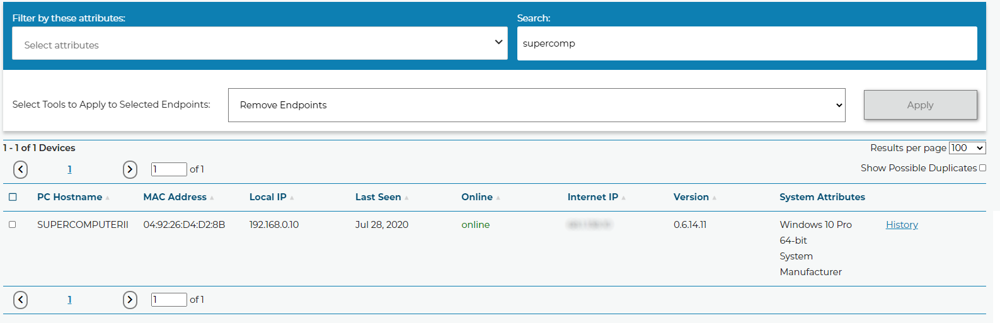
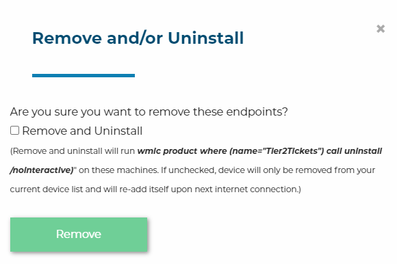
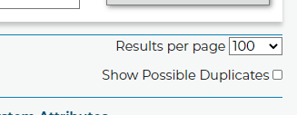

# Duplicates and Uninstalling

## Uninstalling via Helpdesk Buttons

To make this process a bit simpler we have added the ability to uninstall endpoints remotely this feature will only work on endpoints with version 0.6.x or newer.

Select the endpoint(s) you wish to remove, select Remove Endpoints and click Apply.



The next popup confirms the remove and gives the option to run the uninstall command on the endpoints chosen.

Uninstalling using this method will ignore the endpoint from then on. In the event that the uninstall fails, the endpoint will no longer be able to check in.



## Uninstalling Manually (Windows)

Since the package is an MSI, you can use WMI to uninstall it. Here is an example command to uninstall it silently:

`wmic product where (name="Tier2Tickets") call uninstall /nointeractive`

NOTE: if you get back "ReturnValue = 1603;" from this command, then the removal failed because you are not in an elevated command prompt.

An equivalent PowerShell command would be:

`(Get-WmiObject -Class Win32_Product | Where-Object {$_.Name -eq "Tier2Tickets"}).uninstall()`

## Uninstalling Manually (macOS)

The macOS version of the software ships with a preconfigured uninstall script located in the application bundle. You can run this script to remove the software from your system with the following commands as root (or using `sudo`):

```bash
chmod +x /Applications/.Tier2SVC.app/Contents/uninstall.sh
/Applications/.Tier2SVC.app/Contents/uninstall.sh
```

### Removing Components Individually

If the uninstall script fails or you encounter any issues, you may need to manually remove components of the software from your system. This can be done with the following commands as root (or using `sudo`):

```bash
# remove your custom branded app
rm -rf /Applications/YOUR_CUSTOM_BRANDED_APP.app

# unregister launch agents and daemons
pkgutil --forget com.tier2tickets.tier2tickets 2>/dev/null
rm /Library/LaunchAgents/com.tier2tickets.agent.plist 2>/dev/null
rm /Library/LaunchDaemons/com.tier2tickets.daemon.plist 2>/dev/null

# unload the daemon from launchctl
launchctl bootout system/com.tier2tickets.daemon 2>/dev/null

# remove remaining files and directories
rm -rf /var/Tier2Tickets
rm -rf /Applications/.Tier2SVC.app
```

This will remove all system-wide components of the software, including the application, launch agents, daemons, and any remaining files and directories. User-specific shortcuts and dock icons will need to be removed manually for each user.

## Managing Duplicate Endpoints

There is a checkbox on the Device Management page that will filter the list of endpoints for duplicate hostnames. For the most part it is rare for a duplicate to appear, but fully uninstalling and reinstalling the software will create a duplicate endpoint. Replacing the hard drive or the motherboard in a PC running the software will also create a duplicate. Upgrading the software will not.



## Automatically Trim Licenses

To help manage Licenses, you may want to automatically remove endpoints that aren't in use. On the [integrations page](https://account.helpdeskbuttons.com/backend.php), you can opt in to automatically trim endpoints and devices that don't check in for three months with be removed from your licensing. Just tic the checkbox that reads `Auto-Remove endpoints that fail to check-in for 90 days`.

If, at any point, the device comes back online and subsequently checks back in, it will be re-added.
