Zendesk Documentation
=====================

This guide will show you how to set up your new Helpdesk Buttons with Zendesk in as few as 15 minutes.

Integration
-----------

Set up the Zendesk integration in three steps.

#. Optionally create a catchall contact if you will not use ``auto_reg``.
#. Create an OAuth client, or use the alternate instructions for an existing API token.
#. Configure your Helpdesk Buttons account.

.. important::

   New integrations should use OAuth. Existing API Token integrations must
   move to OAuth before **April 30, 2027**. Follow Step 2 below to set up OAuth.

Video Walkthrough
^^^^^^^^^^^^^^^^^

.. raw:: html

    

        <iframe width="560" height="315" src="https://www.youtube.com/embed/rRK2_tzN4y8" frameborder="0" allow="accelerometer; autoplay; clipboard-write; encrypted-media; gyroscope; picture-in-picture" allowfullscreen></iframe>
    

1) Unregistered Contact (Optional)
^^^^^^^^^^^^^^^^^^^^^^^^^^^^^^^^^^

This step is only needed if you will not use ``auto_reg``. The catchall contact
receives tickets from users who are not already in your Zendesk account.

If you use ``auto_reg``, skip this step. The integration can automatically
create Zendesk users using their email addresses. Enable ``auto_reg`` under
Integration Defaults when completing Step 3.

Hover over **Add** and click **User**.

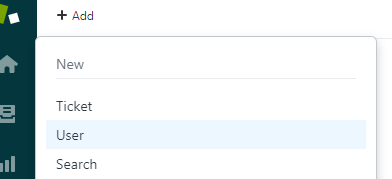

Set the email address to ``unregistered@helpdeskbuttons.com``. You can choose any name for this contact.

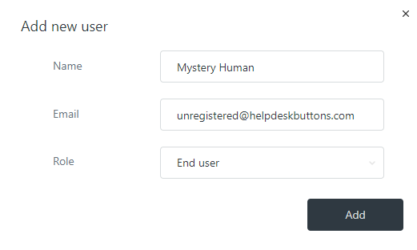

2) Create an OAuth Client
^^^^^^^^^^^^^^^^^^^^^^^^^

Sign in to Zendesk as an administrator and open
**Admin Center > Apps and integrations > APIs > OAuth clients**.

Add a new client and configure these settings.

.. list-table::
   :header-rows: 1
   :widths: 30 70

   * - Setting
     - Value
   * - Client name
     - Tier2Tickets
   * - Identifier
     - ``tier2tickets``, or another unique identifier
   * - Client kind
     - **Confidential**
   * - Redirect URIs
     - Leave empty
   * - Allowed scopes
     - Select **read** and **write**

Save the client and copy its **Identifier** and generated **Secret**.
Store the secret securely when Zendesk displays it.

This integration uses the client credentials flow. Zendesk associates its
access tokens with the user who created the OAuth client, so that user
must have permission to look up users, create tickets, and update ticket
comments.

See `Zendesk's OAuth setup documentation
<https://developer.zendesk.com/documentation/authentication/oauth-migration/#setting-up-an-oauth-client>`_
for details.

Keep the Identifier and Secret available, then continue to Step 3.

.. _enable-api-access-and-create-a-new-key:

2) Alternate: Use an Existing API Token
^^^^^^^^^^^^^^^^^^^^^^^^^^^^^^^^^^^^^^^

API Token authentication is available for existing integrations with an
active token. Zendesk has stopped issuing new API tokens. Use the OAuth
setup instructions above for new integrations.

The screenshots below show the older API settings interface.

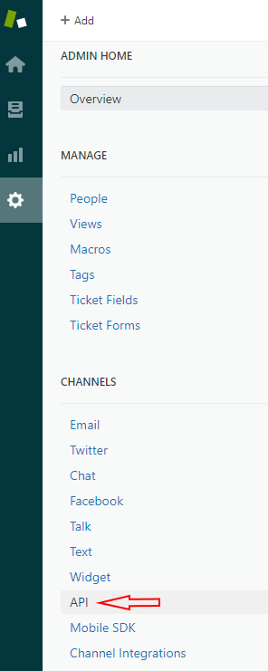

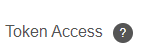

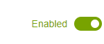

Keep your existing token available if you need to update your integration
before moving to OAuth. Continue to Step 3 with your existing token.

3) Connect Helpdesk Buttons / Tier2Tickets
^^^^^^^^^^^^^^^^^^^^^^^^^^^^^^^^^^^^^^^^^^

Open **Integration Settings** in your Helpdesk Buttons account.

#. Select **Zendesk** as the ticket system.

#. Enter your Zendesk hostname in **Ticket System API endpoint**, such as
   ``yourcompany.zendesk.com``. Omit ``https://`` and any path.

#. Select **API Token** or **OAuth** under **Zendesk Authentication**.

#. Enter the credentials for your selected authentication method.

   **OAuth**

   .. code-block:: text

      tier2tickets:YOUR_CLIENT_SECRET

   Replace ``tier2tickets`` with the Identifier you chose in Step 2.

   **API Token (legacy)**

   .. code-block:: text

      username:apikey

#. If you skipped Step 1, enable ``auto_reg`` under Integration Defaults.
   See the ``auto_reg`` instructions below.

#. Click **Update** to save your settings.

#. Review the Priority, Status, and Type choices loaded from Zendesk.
   Save any changes, then click **Integration Test**. Confirm that the
   ticket appears in Zendesk and includes the private report comment.

Contact us for feature requests and additional integration customizations.

Integration Defaults
--------------------

*auto_reg*
^^^^^^^^^^

The ``auto_reg`` flag allows users to be automatically registered using
their email address. If a user mistypes their email address, a new user
record will be created for that address.

To set ``auto_reg`` as an integration default, add it as a custom field.

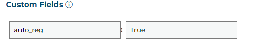

Click **Update** to save the changes. The result should look like this.

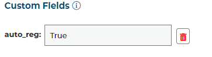

Antivirus and Antimalware
-------------------------

It is not always necessary, but we recommend whitelisting the tier2tickets installation folder (C:\\Program Files(x86)\\tier2tickets). We regularly submit our code through VirusTotal to make sure we are not getting flagged, but almost all AV/M interactions cause some sort of failure. `Webroot <https://docs.tier2tickets.com/content/general/firewall/#webroot>`_ in particular can cause issues with screenshots.

Dispatcher Rules
----------------

This is the list of variables that can be accessed when using the :ref:`Dispatcher Rules <content/automations/dispatcher:Dispatcher Rules>`.

.. list-table::
   :header-rows: 1
   :widths: 50 50

   * - Read/Write
     - Read Only
   * - :ref:`content/integration/zendesk:*priority*`
     - :ref:`content/automations/dispatcher:*selections*`
   * - :ref:`content/integration/zendesk:*type*`
     - :ref:`content/automations/dispatcher:*hostname*`
   * - :ref:`content/integration/zendesk:*status*`
     - :ref:`content/automations/dispatcher:*name*`
   * - :ref:`content/integration/zendesk:*priv_append*`
     - :ref:`content/automations/dispatcher:*email*`
   * - :ref:`content/automations/dispatcher:*msg*`
     - :ref:`content/automations/dispatcher:*ip*`
   * - :ref:`content/automations/dispatcher:*subject*`
     - :ref:`content/automations/dispatcher:*mac*`
   * - :ref:`content/automations/dispatcher:*append*`
     - :ref:`input_cell <zendesk-input-fields>`
   * -
     - :ref:`input_phone <zendesk-input-fields>`
   * -
     - :ref:`input_company <zendesk-input-fields>`
   * -
     - :ref:`input_email <zendesk-input-fields>`
   * -
     - :ref:`input_name <zendesk-input-fields>`

Field Definitions
^^^^^^^^^^^^^^^^^

*priority*
""""""""""

**The ticket priority level (Urgent, Low, etc.):**

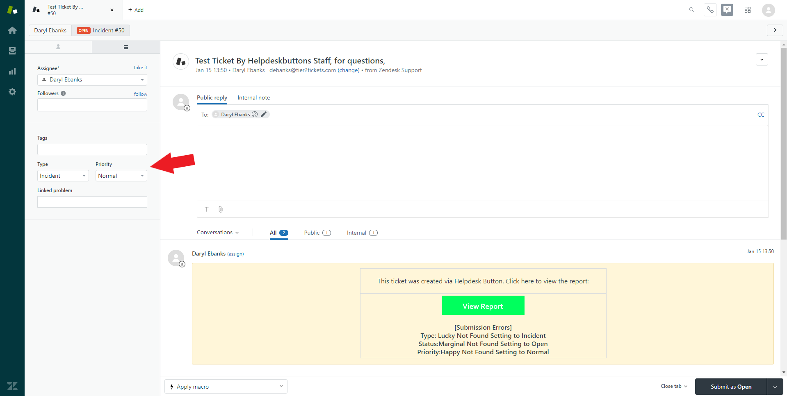

*status*
""""""""

**The ticket status (New, In Progress, etc):**

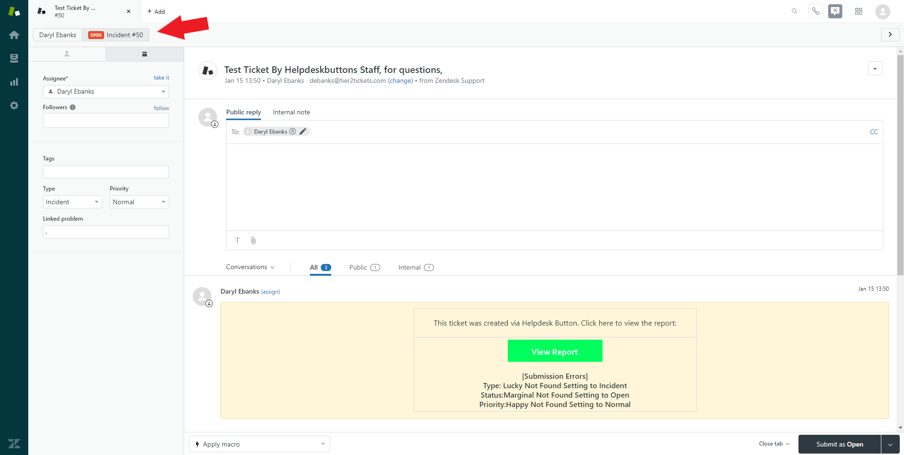

*type*
""""""

**Refers to the issue type (Service Request, Incident, Problem, Alert):**

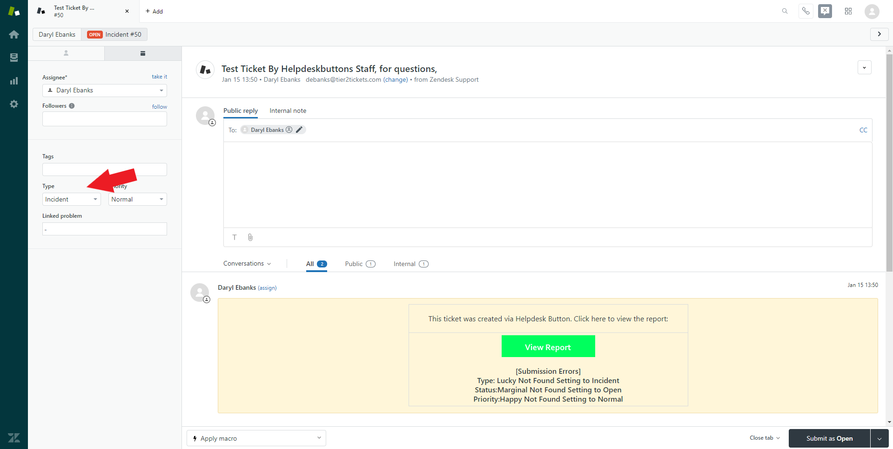

*priv_append*
"""""""""""""

**Allows you to append information to the internal ticket note:**

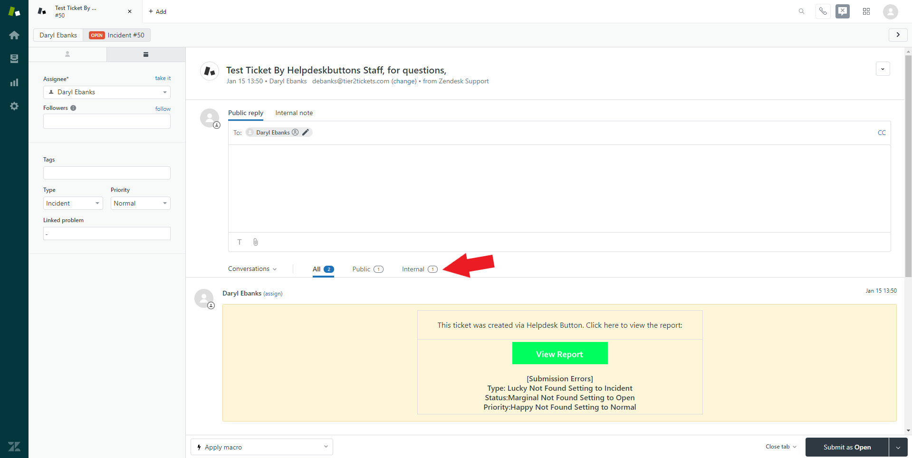

.. _zendesk-input-fields:

``input_*``
"""""""""""

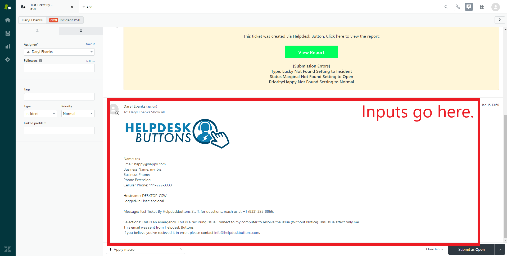

*other*
"""""""

There are additional variables which are common to all integrations. Those are documented :ref:`here <content/automations/dispatcher:Universally Available Variables>`.

The fields labeled ``input_*`` contain information entered by the user
when the user is not found in Zendesk.

Webhook Walkthrough
-------------------

.. note::

   This section describes the legacy Zendesk target and trigger setup.
   See `Zendesk's removal notice
   <https://support.zendesk.com/hc/en-us/articles/360056379854-Removal-of-Zendesk-Connect>`_
   before using this workflow.

The legacy setup has two steps.

1) Create a Target for the Webhook
^^^^^^^^^^^^^^^^^^^^^^^^^^^^^^^^^^

Navigate to **Admin > Settings > Extensions**.

Click **Add target**, then **HTTP Target**.

- Name the Target
- URL should be listed on your `Integration Settings Page. <https://dev.helpdeskbuttons.com/backend.php>`_ under the Ticket Notification section.
- Select POST as the request type
- Set Content type to JSON

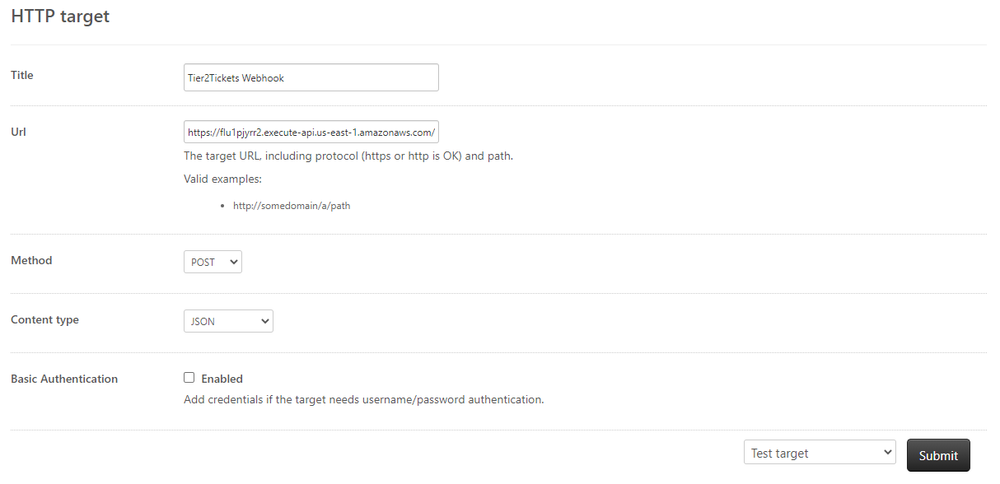

2) Set Up a Trigger in Zendesk
^^^^^^^^^^^^^^^^^^^^^^^^^^^^^^^

Navigate to **Admin > Triggers**.

Click **Add Trigger**.

- Name the Trigger
- Set Ticket is Updated as the condition

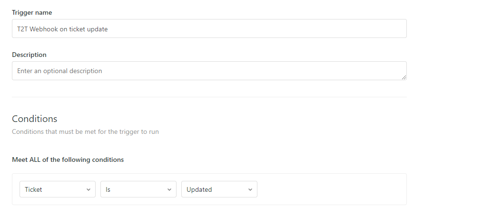

- Select the Action Notify Target
- Select the webhook target created in the previous step
- Add this code into the JSON body of the action

.. code-block:: json

    {
        "actor":"{{current_user.name}}",
        "role":"{{current_user.role}}",
        "assigned_to":"{{ticket.assignee.name}}",
        "message":"{{ticket.verbatim_description}}",
        "ticket_id":"{{ticket.id}}",
        "name":"{{ticket.requester.name}}",
        "company":"{{ticket.organization.name}}",
        "status":"{{ticket.status}}",
        "subject":"{{ticket.title}}",
        "comment":"{{ticket.latest_public_comment_rich}}",
        "email":"{{ticket.requester.email}}",
        "phone":"{{ticket.requester.phone}}"
    }

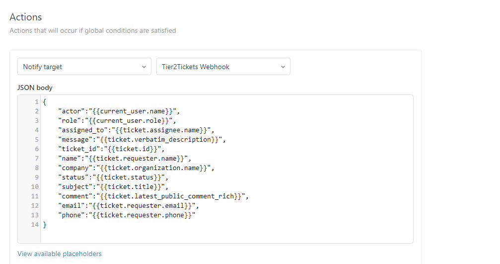
